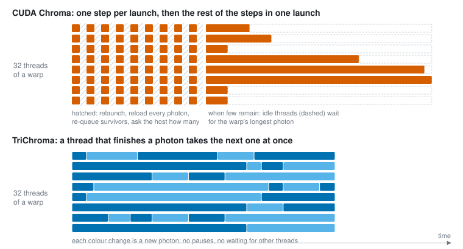
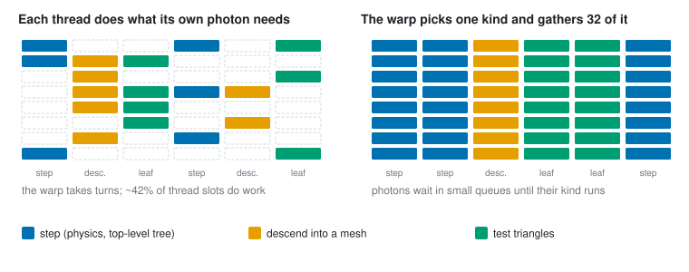
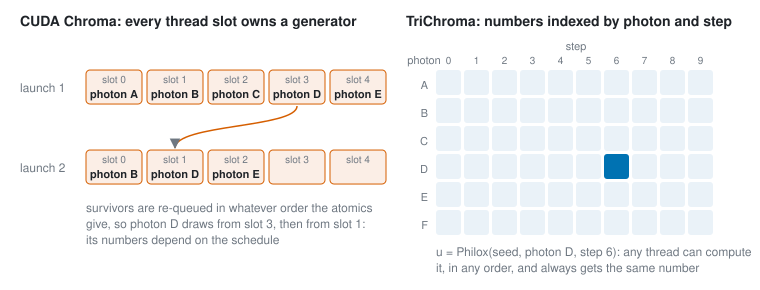
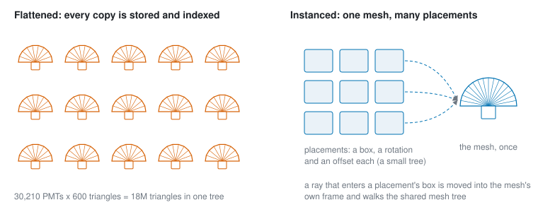
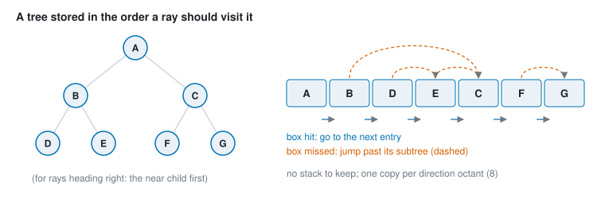
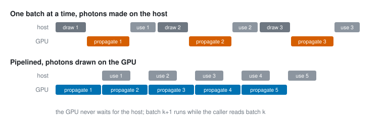

# How TriChroma scales

TriChroma simulates the same physics as CUDA Chroma, 15 to 75 times faster
on the same GPU. None of that comes from approximations. It comes from
organising the same work so that the GPU stays busy. This page explains the
ideas, without code.

| | CUDA Chroma | TriChroma |
|---|---|---|
| Threads | one thread per photon, relaunched every step | long-lived threads, each given a new photon as soon as its last one ends |
| Divergent work | each thread follows its own photon | one kind of work at a time |
| Random numbers | a generator per thread | a function of photon and step |
| Repeated parts | every copy stored | each shape stored once |
| Geometry search | uses a stack | stackless |
| Host | photons made on the CPU; the GPU is idle meanwhile | photons made on the GPU, host work overlapped |

## The job

A photon's life is a random walk: a flight to the next surface or bulk
interaction, then a reflection, refraction, scatter, absorption or detection.
Each step has two parts: a search for the next surface along the photon's
path, which is most of the work, and a little physics.

Photons are independent, so the problem looks perfectly parallel. But a GPU
runs threads in groups of 32, called *warps*, that execute the same
instruction together. A GPU is fast only when every thread in every warp has
work, data stays in registers, and the GPU is never idle waiting for the CPU.
Photon transport breaks all three conditions: photons live for different
numbers of steps, require different work at each step, and die off as the
simulation runs.

## 1. Keep every thread busy

**In CUDA Chroma**, each photon has its own thread. While many photons
remain, each launch advances every photon by one step; the photons are
written back to memory, the survivors are re-queued, and the CPU reads how
many remain before the next launch. When few remain, all their remaining
steps run in one launch, and each warp runs until its longest-lived photon
ends.

**In TriChroma**, the threads are launched once. Each warp holds up to 128
photons, and a thread whose photon ends is immediately given the next one, so
threads are idle only at the very end. This is also why throughput rises with
the number of photons per launch.

## 2. Do one kind of work at a time

A warp executes one instruction for all 32 threads, so a thread whose photon
requires different work sits idle while the others run. In photon transport
this happens constantly: most photons only need the next step, some need a
search through a PMT's triangles, a few are re-emitted.

In TriChroma, pending work is queued by kind, and a warp runs 32 pieces of
one kind at once: 32 steps, or 32 mesh searches from different photons, or 32
triangle tests.

## 3. Random numbers that belong to the photon

**In CUDA Chroma**, each thread has its own random-number generator. A
photon's numbers come from whichever thread runs it, which depends on
scheduling, so a large run never repeats exactly.

**In TriChroma**, each random number is computed from the seed, the photon
and the step (a counter-based generator, Philox). Nothing is stored, and any
thread can compute any photon's numbers at any time. This frees the
scheduling of ideas 1 and 2, and every run repeats exactly for any batch
size.

## 4. Store each shape once

Detectors repeat parts: a large neutrino detector may hold 30,000 identical
PMTs of 600 triangles each. **CUDA Chroma's** geometry contains every copy,
18 million triangles. **TriChroma's** contains the PMT once, plus the
position and orientation of each copy; a ray that reaches a copy is
transformed into the PMT's own frame.

Two more ways to do less work:
- **Simple shapes as themselves.** A box is tested as a box, not as 12
  triangles, and wire planes as cylinders.
- **Skip what cannot be hit.** A tank around the whole detector would
  otherwise be searched by almost every photon. The largest region inside the
  tank that contains no triangle is computed in advance, and the tank is
  skipped while a photon's path stays inside that region.

## 5. Search without a stack

The search for the next surface walks a tree of boxes: a box's contents are
tested only if the ray hits the box. The usual walk keeps a stack of boxes to
return to. In TriChroma, each tree is stored in the order a ray visits it,
with links that skip a missed box's contents, so no stack is required. The
best order depends on the ray's direction, so each tree is stored eight
times, once per direction octant.

The trees are also built more carefully: each split is placed where the
expected cost of a random ray is lowest.

## 6. Keep the GPU fed

- **Make photons on the GPU** (`trichroma.sources`). Generating millions of
  photons with NumPy can take longer than simulating them.
- **Overlap.** The next batch propagates while your code reads the current
  one.
- **Launch big.** Millions of photons per launch keep every thread busy.

## 7. Weighted photons (optional)

In weighted mode (`use_weights=True`), absorption lowers a photon's weight
instead of ending it, so histories run about seven times longer, mostly
carrying photons whose weight is already tiny. *Russian roulette* removes
that tail: once a photon's weight falls below a threshold, it either
continues at the threshold weight or ends, with odds that keep the expected
weight unchanged. Every result stays unbiased and the run is about twice as
fast. It is off by default (`CHROMA_TRITON=roulette=0.05` turns it on).

## Further reading

- T. Aila and S. Laine, *Understanding the Efficiency of Ray Traversal on
  GPUs*, HPG 2009 (persistent threads).
- S. Laine, T. Karras and T. Aila, *Megakernels Considered Harmful: Wavefront
  Path Tracing on GPUs*, HPG 2013.
- J. Salmon, M. Moraes, R. Dror and D. Shaw, *Parallel Random Numbers: As
  Easy as 1, 2, 3*, SC 2011 (Philox).
- B. Smits, *Efficiency Issues for Ray Tracing*, JGT 1998 (skip links).
- I. Wald, *On Fast Construction of SAH-based Bounding Volume Hierarchies*,
  RT 2007.
