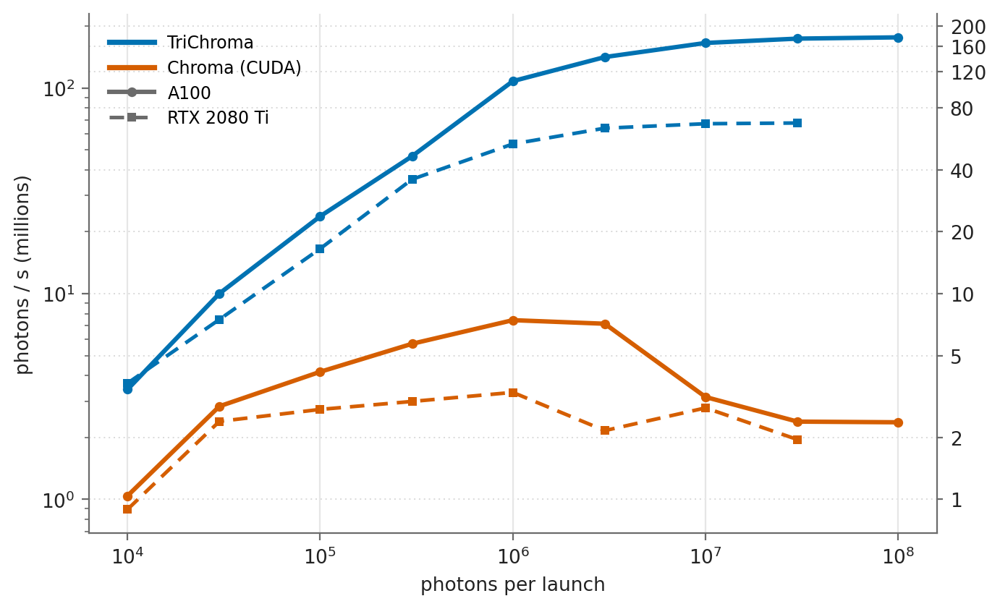
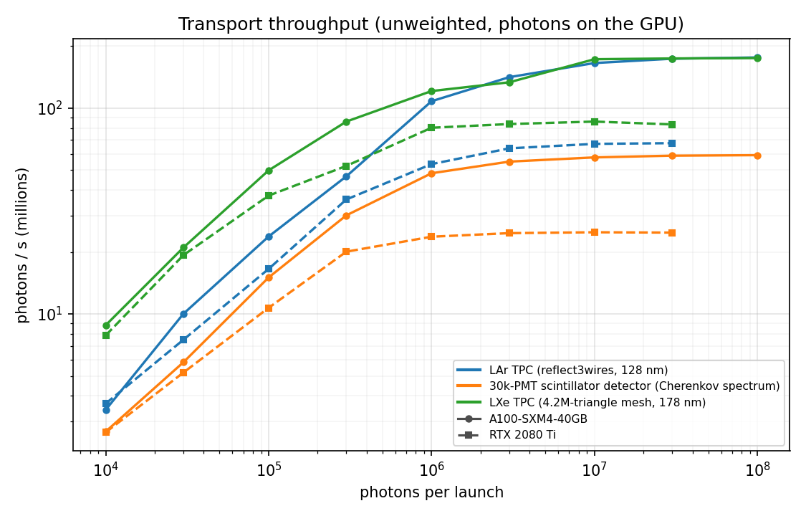

# Performance

## Against CUDA Chroma

The detector is chroma-lar's liquid-argon TPC: 162 PMTs, three wire planes,
and 128 nm light from a point source. In both engines the photons start on
the GPU and run to completion, unweighted; CUDA Chroma runs in its faster
packed mode (`use_packed=True`).

| GPU | Photons per launch | CUDA Chroma | TriChroma | Speed-up |
|---|---|---|---|---|
| A100 | 10^6 | 7.4M/s | 108M/s | 15x |
| A100 | 10^8 | 2.4M/s | 176M/s | 74x |
| RTX 2080 Ti | 10^6 | 3.3M/s | 53M/s | 16x |
| RTX 2080 Ti | 3·10^7 | 2.0M/s | 68M/s | 35x |

CUDA Chroma is fastest near 10^6 photons per launch; TriChroma's throughput
keeps rising with launch size.

## Three kinds of detector

| Detector | A100, 10^6 photons | A100, 10^8 | RTX 2080 Ti, 10^6 | RTX 2080 Ti, 3·10^7 |
|---|---|---|---|---|
| Liquid-argon TPC (128 nm) | 108M/s | 176M/s | 53M/s | 68M/s |
| Theia-like PMT array | 48M/s | 59M/s | 24M/s | 25M/s |
| Liquid-xenon TPC (178 nm) | 121M/s | 175M/s | 80M/s | 83M/s |

- **Liquid-argon TPC:** chroma-lar's detector above; about 17 steps per
  photon.
- **Theia-like PMT array:** 30,210 copies of a 20-inch PMT mesh (18M triangles in all)
  around a liquid scintillator, lit by a Cherenkov spectrum whose ultraviolet
  part the scintillator absorbs and re-emits; about 6 steps per photon.
- **Liquid-xenon TPC:** a 4.2M-triangle CAD model (chroma-lxe); about 1.6
  steps per photon.

## Whole workloads

On an A100, against CUDA Chroma on the same GPU:

| Workload | CUDA Chroma | TriChroma |
|---|---|---|
| Weighted mode (`use_weights=True`), 30M photons in one `simulate()` call | 0.55M photons/s | 21M photons/s; 41M with `roulette=0.05` |
| chroma-lar waveform-map macro | 0.29 s per voxel | 3.1 ms per voxel |
| chroma-lar pixel-detector lookup table, 30M photons per voxel | ~42 s per voxel | 0.22 s per voxel |

- For the two macros, CUDA Chroma's photons come from NumPy and TriChroma's
  are generated on the GPU. They were measured with an earlier, slower TriChroma
  version, using the chroma-lar branch
  [`trichroma-fast-waveform`](https://github.com/youngsm/chroma-lar/tree/trichroma-fast-waveform).
- Scripts that keep generating photons with NumPy speed up only 2 to 5
  times: making the photons becomes the bottleneck.
- CUDA Chroma's wire bug ends many photons early on these detectors, which
  shortens its runs ([user guide](guide.md#what-changes-in-your-results)).

## Reproducing the numbers

- `benchmarks/throughput_scaling.py` and `benchmarks/plot_scaling.py`
  measure and plot throughput against photons per launch, for any detector.
  The measured points are in `img/scaling_data/`.
- `benchmarks/simulate_throughput.py` times whole `simulate()` calls on
  either backend.
